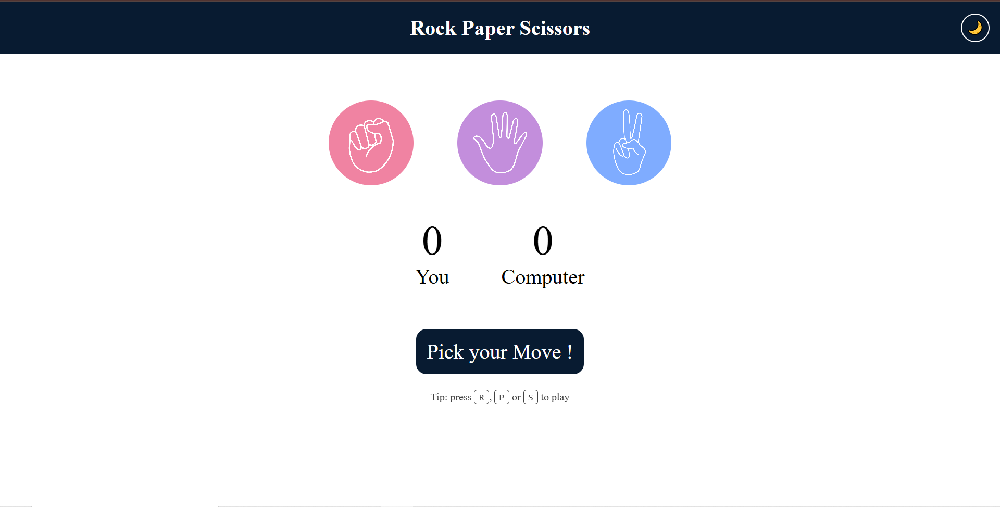
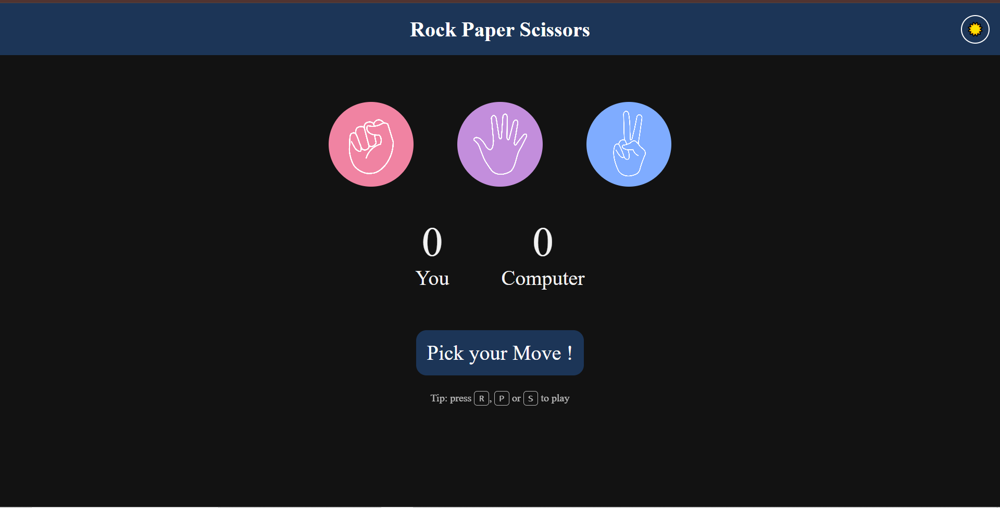

# 🎮 Rock Paper Scissors

A fun and interactive **Rock Paper Scissors** game built using **HTML, CSS, and JavaScript** — now live with **GitHub Pages deployment 🚀**

---

## 🌐 Live Demo

👉 https://jaikaran109.github.io/Rock-Paper-Scissors/

| Light Mode | Dark Mode |
| :---: | :---: |
|  |  |

---

## ✨ Features

* 🖱️ Click-based gameplay
* ⌨️ **Keyboard shortcuts** — play with `R`, `P` and `S`
* 🌗 **Light / Dark mode** — one-click toggle that follows your system theme and remembers your choice
* 🤖 Random computer moves
* 📊 Real-time score tracking
* 🎨 Dynamic result messages (Win/Lose/Draw)
* 📱 **Fully responsive** — works on phones, tablets and desktops, including landscape mode
* ♿ **Accessible** — image alt text, labelled theme toggle, keyboard shortcut hints for screen readers and visible focus styles

---

## 🛠️ Tech Stack

* **HTML5** – Structure
* **CSS3** – Styling, CSS variables for theming, Flexbox and `clamp()` for responsive layout
* **JavaScript** – Game logic, keyboard shortcuts, theme handling & DOM manipulation
* **GitHub Actions** – Automatic deployment

---

## 📂 Project Structure

```
Rock-Paper-Scissors/
│── index.html      # Page structure and theme toggle button
│── script.css      # Styles, theme variables and responsive layout
│── app.js          # Game logic, keyboard shortcuts and theme handling
│── images/
│     ├── rock.png
│     ├── paper.png
│     └── scissors.png
│── .github/
│     └── workflows/
│           └── deploy.yml
```

---

## 🎯 How to Play

1. Choose **Rock, Paper, or Scissors** by clicking a circle or pressing a key
2. Computer makes a random choice
3. Result is displayed instantly:

   * ✅ Win → Green
   * ❌ Lose → Red
   * 🤝 Draw → Default

Classic rules apply: Rock beats Scissors, Scissors beats Paper, Paper beats Rock.

### ⌨️ Keyboard Shortcuts

| Key | Action            |
| --- | ----------------- |
| `R` | Play **Rock**     |
| `P` | Play **Paper**    |
| `S` | Play **Scissors** |

Shortcuts are ignored when a modifier key is held (so `Ctrl + R` still reloads the page) and while typing in a text field.

### 🌗 Light / Dark Mode

Click the 🌙 / ☀️ button in the top-right corner to switch themes. On your first visit the game follows your operating system's theme, and your choice is saved in the browser (`localStorage`) for next time.

---

## 🧩 How It Works

* **Theming** — colors are defined as CSS variables on `:root`, and a `[data-theme="dark"]` block overrides them. A small inline script in `<head>` applies the saved theme before the page paints, preventing a white flash on reload.
* **Responsiveness** — sizes use `clamp()` and `vw`/`vh` units, so the layout scales smoothly instead of jumping between fixed breakpoints. Hover effects only apply on devices that support hover, so they don't stick on touch screens.
* **Keyboard shortcuts** — a single `keydown` listener maps `R`, `P` and `S` to a choice and calls the same `playGame()` function used by mouse clicks.
* **Result colors** — win and lose states are CSS classes (`.win` / `.lose`), so they work in both themes.

---

## ⚙️ Deployment

This project uses **GitHub Actions** for automatic deployment:

* Every `git push` triggers deployment
* Website is published using **GitHub Pages**
* No manual steps required after setup

---

## 🚀 Getting Started (Local Setup)

```bash
git clone https://github.com/jaikaran109/Rock-Paper-Scissors.git
cd Rock-Paper-Scissors
```

👉 Open `index.html` in browser
OR
👉 Use **Live Server** in VS Code

---

## 🔥 Future Improvements

* 🎵 Add sound effects (with a mute toggle)
* ✨ Add animations
* 🔄 Reset button
* 💾 Save the score in `localStorage`
* 🏆 Best-of-3 / best-of-5 mode
* 🖼️ Show computer choice visually
* 🧪 Unit tests for the game logic

---

## 🤝 Contributing

Contributions are welcome!

1. Fork the repository
2. Create a feature branch: `git checkout -b feature/your-feature-name`
3. Commit your changes: `git commit -m "Add your feature"`
4. Push the branch: `git push origin feature/your-feature-name`
5. Open a Pull Request

Please check the open issues first, keep each PR focused on one change, and include before/after screenshots for UI changes.

---

## 🙌 Author

**Jai Karan**

---

## 💡 Note

This project is great for beginners to learn:

* DOM manipulation
* Event handling
* Game logic
* Responsive design and theming with CSS variables
* Git & GitHub workflows

---

⭐ If you like this project, feel free to fork and improve it!